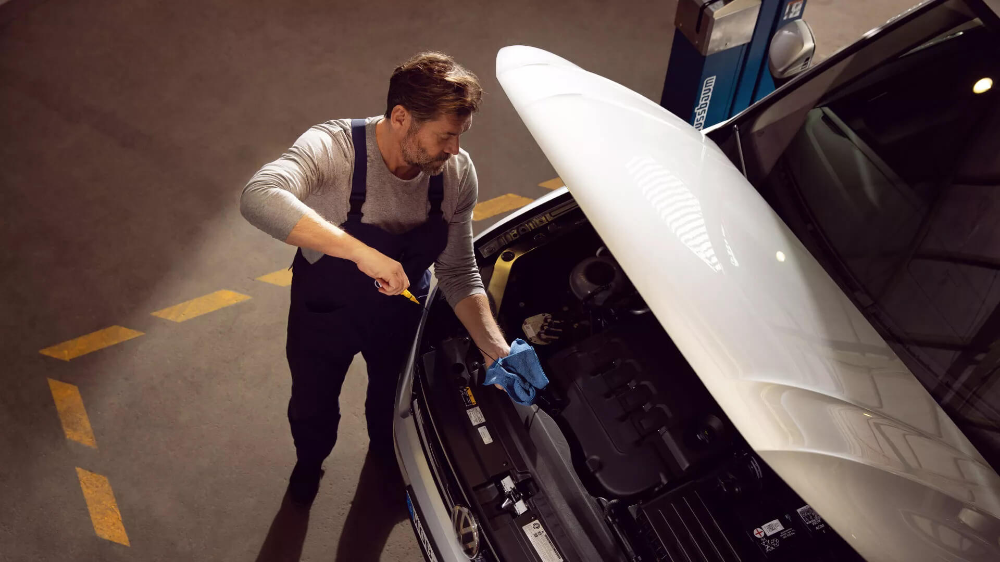

<p align="center">
  
</p>

<h1 align="center">Asaf Auto Sales — Multi-Dealership Volkswagen Platform</h1>

<p align="center">
  <strong>Newcastle Volkswagen · Ermelo Volkswagen · Vryheid Volkswagen</strong><br />
  <sub>Asaf Auto Sales (Pty) Ltd · Authorised Financial Services Provider (FSP No. 13411)</sub>
</p>

<p align="center">
  <a href="https://ais-dev-timkkvl7vvu6ezhf6l4stl-25416689419.europe-west2.run.app/?branch=1">Newcastle VW Preview</a> ·
  <a href="https://ais-dev-timkkvl7vvu6ezhf6l4stl-25416689419.europe-west2.run.app/?branch=2">Ermelo VW Preview</a> ·
  <a href="https://ais-dev-timkkvl7vvu6ezhf6l4stl-25416689419.europe-west2.run.app/?branch=3">Vryheid VW Preview</a> ·
  <a href="https://ais-dev-timkkvl7vvu6ezhf6l4stl-25416689419.europe-west2.run.app/admin">Admin CMS</a>
</p>


---

## Dealership Branches & Live Links

A single compiled build powers all three Volkswagen dealerships dynamically via hostname resolution (`ermelovw`, `vryheidvw`, `newcastlevw`) or runtime `?branch=1|2|3` query overrides.

| ID | Dealership | Location | Reception | Production Domain | Testing Preview Link |
| :---: | :--- | :--- | :--- | :--- | :--- |
| **1** | **Newcastle Volkswagen** | 77 Allen Street, Newcastle, 2940 (KZN) | `034 328 3600` | [www.newcastlevw.co.za](https://www.newcastlevw.co.za) | [Open Branch 1](https://ais-dev-timkkvl7vvu6ezhf6l4stl-25416689419.europe-west2.run.app/?branch=1) |
| **2** | **Ermelo Volkswagen** | 52 Kerk Street, Ermelo, 2351 (MP) | `017 801 7600` | [www.ermelovw.co.za](https://www.ermelovw.co.za) | [Open Branch 2](https://ais-dev-timkkvl7vvu6ezhf6l4stl-25416689419.europe-west2.run.app/?branch=2) |
| **3** | **Vryheid Volkswagen** | Van Riebeeck Street, Vryheid, 3100 (KZN) | `034 980 9717` | [www.vryheidvw.co.za](https://www.vryheidvw.co.za) | [Open Branch 3](https://ais-dev-timkkvl7vvu6ezhf6l4stl-25416689419.europe-west2.run.app/?branch=3) |

> **Shared Staging Mirror:** Replace the host above with [`ais-pre-timkkvl7vvu6ezhf6l4stl-25416689419.europe-west2.run.app`](https://ais-pre-timkkvl7vvu6ezhf6l4stl-25416689419.europe-west2.run.app/?branch=1) for shared review sessions (`?branch=1`, `?branch=2`, `?branch=3`).

---

## Visual Showcase

| Group Showroom &amp; MasterCars | Approved Service Workshop | Genuine OEM Parts &amp; Finance |
| :---: | :---: | :---: |
|  |  |  |
| *Shared New, Used &amp; 80-point certified MasterCars stock with branch badges* | *Validated Service &amp; Parts bookings (VIN, Reg &amp; mileage checks)* | *ZAR finance calculator &amp; scoped branch specials* |

---

## Core Features

- **Runtime Multi-Branch Resolution**: Automatically adapts dealership branding, address, Google Maps embed, WhatsApp integration (Ermelo & Vryheid), trading hours, SEO `<title>` / meta tags, and booking reference codes (`NVW-`, `EVW-`, `VVW-`).
- **Master Group Inventory (`/vehicles`)**: Displays all available New, Used, and MasterCars units across all three dealerships with holding-branch filters and dual lead attribution (`submittedAtDealershipId` + `homeDealershipId`).
- **Scoped Campaigns & Auto-Archive (`/specials`, `/news-events`)**: Specials, events, and prize competitions target either **All Dealerships (`MASTER`)** or a single branch (`BRANCH`), archiving automatically past their `validUntil` date.
- **Aftersales & Booking Validation (`/test-drive`, `/aftersales`, `/finance`)**: Enforces test-drive hours (`Mon–Fri 09:00–15:00`, `Sat 09:00–11:00`, `Sun Closed`), mandatory Service VIN/Reg/Mileage checks, Parts VIN/Reg fitment checks, and interactive ZAR instalment calculations.
- **Multi-Branch Admin CMS (`/admin`)**: Google-authenticated portal for managing Master Stock, Promotions with a 4-option visibility selector, live Branch Settings, Motoring News, and incoming Customer Leads.

---

## Tech Stack

- **Frontend**: React 19, TypeScript, Vite 8, Tailwind CSS v4, Motion (`motion/react`), Lucide Icons
- **Backend & Data**: Cloud Firestore, Firebase Authentication, Deployed Firestore Security Rules (`firestore.rules`)
- **Hosting Targets**: Host-agnostic `dist/` bundle with Apache SPA rewrites (`public/.htaccess` for cPanel) and `firebase.json` (Firebase Hosting)

---

## Local Setup & Commands

```bash
# 1. Install dependencies
npm install

# 2. Start local dev server on port 3000
npm run dev

# Test each branch locally:
#   http://localhost:3000/?branch=1  (Newcastle VW)
#   http://localhost:3000/?branch=2  (Ermelo VW)
#   http://localhost:3000/?branch=3  (Vryheid VW)

# 3. Type-check and build production bundle (outputs to dist/)
npm run lint
npm run build
```

## Deployment

- **cPanel Hosting**: Run `npm run build` and upload the contents of `dist/` (including `.htaccess`) to each dealership's `public_html/` directory—no separate builds or `.env` changes needed per domain.
- **Firebase Hosting / Rules**:

```bash
firebase deploy --only hosting,firestore:rules
```
